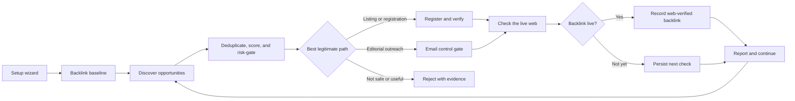

<p align="center">
  
</p>

# Backlink Hunter

**A portable Agent Skill for finding, earning, tracking, and verifying high-quality backlinks—without turning your AI agent into a spam cannon.**

Backlink Hunter gives a skills-compatible AI agent a persistent, safety-first workflow for improving the backlink profile of a domain you own or are authorized to represent. It establishes a baseline, studies competitors, builds and ranks a durable opportunity pipeline, handles qualifying registrations, controls outreach, watches the inbox, and verifies live backlinks on the web.

It is free, open source, vendor-neutral, and designed around the [open Agent Skills specification](https://agentskills.io/specification).

> Backlink Hunter optimizes for durable, relevant, web-verified links—not messages sent, accounts created, or raw directory volume.

## Quick start: paste this into your agent

```text
Install the backlink-hunter Agent Skill from:
https://github.com/nova-centauri/backlink-hunter-skill

Inspect the skill and its local script before installing it. Install the
`backlink-hunter` directory as a user-level skill, invoke it, and immediately
start its four-question setup wizard. Do not browse, access my inbox, create
accounts, submit forms, or send anything until I answer the wizard.
```

That prompt asks a capable agent to install **and** invoke the skill. Installation alone does not access an inbox, crawl a site, create an account, or send email.

On first invocation, Backlink Hunter asks:

1. **Target domain?**
2. **Email mode?** `read-only`, `restricted`, or `unrestricted`
3. **Crawling assist?** `auto`, `standard-web`, or `off`
4. **Run mode?** `goal`, `loop`, or `schedule`

The safest starting configuration is `read-only` + `auto` + `goal`.

## Domain-neutral and privacy-first

The published skill contains no configured target, inbox address, sender identity, brand profile, credentials, or campaign state. Every target domain is supplied at runtime through the setup wizard. Sample target domains and email addresses in documentation/tests use IANA-reserved `example.*` names only.

The local control script has no telemetry, makes no network requests, and sends no email. It creates runtime state only inside the user's chosen workspace and writes a deny-by-default `.gitignore` to reduce the chance of committing campaign records. Inbox access remains inside the host agent's separately connected email capability.

## What it does



Backlink Hunter can:

- snapshot the current backlink baseline and preserve comparable historical snapshots;
- identify defensible search/business competitors and mine legitimate competitor link gaps;
- discover unlinked mentions, broken resources, curated resource pages, associations, chambers, professional groups, reputable directories, community organizations, local citations, partner listings, expert-source requests, and linkable-asset opportunities;
- rank each opportunity for relevance, quality, audience value, viability, cost, difficulty, target-page fit, and risk;
- create qualifying free factual listings and complete expected email verification flows;
- propose tightly personalized outreach and enforce the selected email mode;
- monitor known registration/outreach threads without reading unrelated inbox content;
- distinguish earned editorial, `nofollow`, `ugc`, and `sponsored` links;
- verify that a backlink actually exists on a live page before counting it as success;
- track attempts, replies, declines, suppressions, promised placements, lost links, and next checks across sessions;
- maintain evidence-backed **disavow candidates** while preventing automatic or casual disavow uploads.

## Requirements and optional accelerators

### Required

- A target domain the user owns or is authorized to represent.
- An inbox capability supplied by the host agent for registration verification and, when permitted, outreach.
- Durable local files or equivalent persistent storage for safe multi-cycle operation.

The skill does **not** bundle an email provider, inbox credentials, or a sending service. Most agent hosts already provide or can connect an inbox, and keeping that capability separate makes the skill easier to audit and share.

### Strongly recommended, but optional

| Capability | What it improves | Examples |
|---|---|---|
| SEO/backlink index | Baseline coverage, referring domains, competitor gaps, gained/lost links | Semrush, Ahrefs, Moz, Majestic, user exports |
| Web crawler/extractor | Page qualification, broken-link checks, redirects, live verification | Firecrawl or an equivalent crawler |
| Approval system | Exact, durable per-message authorization in restricted mode | Host approval gates, review queues, explicit in-chat approval |
| Goal/scheduler | Durable progress and recurring checks | Host goals, loops, wakeups, scheduled tasks |

No specific vendor is required. When an integration is unavailable, the skill uses a documented fallback and labels incomplete data honestly. It never silently installs, connects, or purchases an optional service.

## Email control system

The selected mode controls **outbound communications**, including email, contact forms, support tickets, and direct messages that deliver a pitch.

| Mode | Inbox and verification | Outbound outreach |
|---|---|---|
| **Read-only** | May narrowly read relevant messages and open a safe, expected registration-verification link | Never sends; may draft for review |
| **Restricted** | Same as read-only | Every exact recipient, subject, and body requires fresh, message-specific approval |
| **Unrestricted** | Same as read-only | May send without per-message approval, but only through all safety gates and hard low-volume caps |

“Unrestricted” does not mean unlimited. The built-in ceilings are:

- 5 total outbound messages in any rolling 24 hours;
- 20 total outbound messages in any rolling 7 days;
- one initial request per recipient/opportunity;
- one follow-up at most, no sooner than 7 full days later;
- no follow-up after a reply, decline, bounce, opt-out, complaint, or resolved outcome.

Backlink Hunter also maintains address/domain suppressions, rejects guessed or bulk-scraped recipients, caps messages at 120 words, and prohibits deceptive subjects, tracking pixels, link shorteners, and automated negotiation.

See [email-controls.md](backlink-hunter/references/email-controls.md) for the complete policy.

## Machine-checkable send guardrails

The included `scripts/backlink_hunter.py` uses only Python's standard library. It does not access the network and cannot send email. Instead, it:

- initializes per-domain state;
- rejects opportunity, outreach, and verification targets outside the configured domain (subdomains are allowed);
- stores normalized opportunities and attempt history;
- creates exact immutable email proposals;
- binds restricted-mode approval to recipient + subject + body + opportunity;
- expires approvals after 24 hours;
- checks suppressions, duplicate sends, follow-up timing, and rolling caps;
- issues a one-time send token that expires after 15 minutes;
- records the provider message ID after the host inbox connector confirms a send;
- preserves baseline snapshots, backlink verification, disavow-review evidence, and audit events in SQLite.

The host agent's existing email connector remains responsible for the actual send.

Runtime data lives in the user's active workspace:

```text
.backlink-hunter/
├── .gitignore
└── example.com/
    ├── config.json
    └── state.sqlite3
```

The local initializer writes a deny-by-default `.gitignore` so campaign state is not accidentally committed. No credentials, passwords, API keys, cookies, or verification codes belong in that directory.

## Run modes

### Goal

Pursue a measurable outcome using durable state. The default is **one new quality, web-verified backlink**. A message sent or placement promised is progress, not completion.

### Loop

Run one bounded cycle per wakeup, defaulting to every 24 hours. The skill never uses a tight shell loop, repeated refresh, long blocking sleep, or concurrent swarm against the same target.

### Schedule

Use the host's recurring-task mechanism after the user supplies cadence, local time, and timezone. A useful starting pattern is weekly discovery, daily checks while registrations/outreach are active, monthly baseline refreshes, and monthly verified-link health checks.

If the host does not support goals or schedules, Backlink Hunter completes one cycle, saves state, and provides an exact resume prompt.

## Responsible SEO by design

Backlink Hunter rejects tactics that can harm the target domain or other people:

- mass or purchased-list outreach;
- bought links that pass ranking credit;
- private blog networks and expired-domain networks;
- automated directory blasts, fake profiles, reviews, comments, or forum posts;
- hacked, injected, hidden, or deceptive links;
- spun guest posts, manipulative advertorials, or excessive reciprocal schemes;
- invented credentials, relationships, traffic, or reasons for a link.

Legitimate advertising or sponsorship may have referral value, but requires separate user approval and correct `rel="sponsored"` or `nofollow` qualification. The skill follows [Google's current link-spam policy](https://developers.google.com/search/docs/essentials/spam-policies) and [outbound-link qualification guidance](https://developers.google.com/search/docs/crawling-indexing/qualify-outbound-links).

### Disavow is intentionally cautious

The skill collects evidence-backed `disavow-candidate` records; it never automatically uploads, replaces, or cancels a Search Console disavow list. Google describes disavowal as an advanced action that most sites do not need and warns that incorrect use can hurt search performance. A recommendation requires a considerable artificial-link pattern plus a manual action or credible risk of one, followed by human review of the exact merged file. See [Google's disavow guidance](https://support.google.com/webmasters/answer/2648487) and the skill's [quality-and-disavow policy](backlink-hunter/references/quality-and-disavow.md).

## Installation

The distributable skill is the [`backlink-hunter/`](backlink-hunter/) directory. Its directory name intentionally matches the `name` in `SKILL.md`, as required by the Agent Skills specification.

### GitHub CLI skill installer

GitHub CLI 2.90.0+ includes `gh skill` in public preview. Preview untrusted skills before installing:

```bash
gh skill preview nova-centauri/backlink-hunter-skill backlink-hunter
gh skill install nova-centauri/backlink-hunter-skill backlink-hunter
```

GitHub documents host and scope flags for installing to supported agents:

```bash
gh skill install nova-centauri/backlink-hunter-skill backlink-hunter \
  --agent <agent-host> --scope user
```

See [GitHub's Agent Skills installation documentation](https://docs.github.com/en/copilot/how-tos/copilot-on-github/customize-copilot/customize-cloud-agent/add-skills).

### Codex / ChatGPT desktop

Paste the Quick Start prompt above, or ask the built-in installer:

```text
$skill-installer install backlink-hunter from
https://github.com/nova-centauri/backlink-hunter-skill
then invoke $backlink-hunter and start its setup wizard.
```

For manual user-level discovery, place the `backlink-hunter` directory at:

```text
~/.agents/skills/backlink-hunter
```

For a repository-scoped installation, use:

```text
<repository>/.agents/skills/backlink-hunter
```

Codex detects skill changes automatically; restart if an installation does not appear. See the [official OpenAI skill documentation](https://learn.chatgpt.com/codex/build-skills).

### Any Agent Skills-compatible host

Copy the complete `backlink-hunter` directory into the host's personal or project skills directory, preserving its files and subdirectories. Then invoke it by name or ask:

```text
Use backlink-hunter and start the setup wizard.
```

The [Agent Skills client showcase](https://agentskills.io/home) is the best place to find host-specific discovery locations. A host that cannot load `SKILL.md` skills can still use the file as a runbook, but automatic activation and bundled-resource discovery will depend on that host.

## Repository layout

```text
backlink-hunter-skill/
├── .github/
│   └── assets/
│       └── backlink-hunter.png
├── .gitignore
├── README.md
├── LICENSE
├── backlink-hunter/
│   ├── SKILL.md
│   ├── agents/
│   │   └── openai.yaml
│   ├── references/
│   │   ├── email-controls.md
│   │   ├── operating-model.md
│   │   ├── opportunity-model.md
│   │   ├── quality-and-disavow.md
│   │   └── state-and-cli.md
│   └── scripts/
│       └── backlink_hunter.py
└── tests/
    ├── test_backlink_hunter.py
    ├── test_public_release.py
    └── test_skill_contract.py
```

## Local verification

The runtime script has no third-party Python dependencies:

```bash
python3 -m unittest discover -s tests -v
python3 /path/to/skill-creator/scripts/quick_validate.py ./backlink-hunter
```

You can also validate against the open specification with [`skills-ref`](https://agentskills.io/specification):

```bash
skills-ref validate ./backlink-hunter
```

## Limitations

- No backlink index is exhaustive, and providers can report different totals.
- The skill cannot guarantee rankings, replies, placements, indexing, or traffic.
- Web search alone produces a partial baseline; the skill labels it that way.
- Email and scheduled/background execution depend on the host's connected tools and permissions.
- The user remains responsible for their representations, legal obligations, site memberships, and final disavow decisions.

## License

[MIT](LICENSE) — use it, inspect it, adapt it, and share it.
